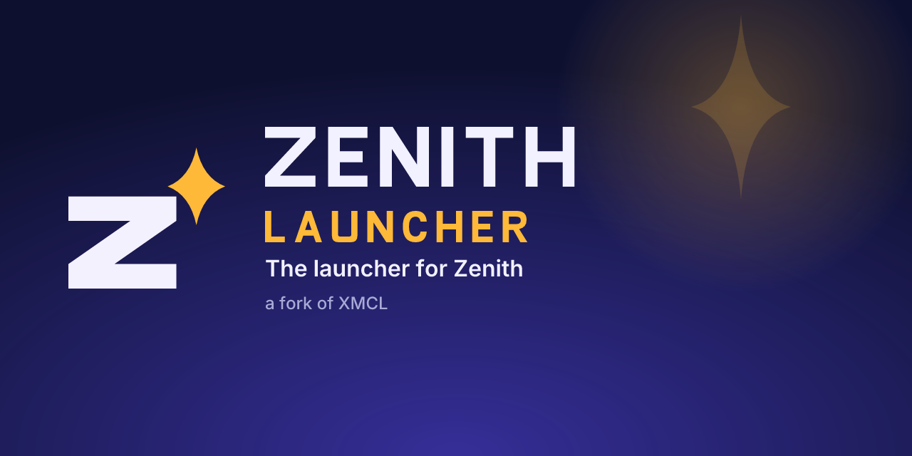

# Zenith Launcher

Zenith Launcher is a fork of [X Minecraft Launcher (XMCL)](https://github.com/Voxelum/x-minecraft-launcher) by Voxelum, with Zenith branding and the
[Zenith](https://github.com/gitzetazero/zenith) bridge built in. **Zenith Launcher is based on X Minecraft Launcher (XMCL) by Voxelum, MIT license.**
XMCL's license and copyright are kept in [`LICENSE`](LICENSE).

NOT AN OFFICIAL MINECRAFT PRODUCT. NOT APPROVED BY OR ASSOCIATED WITH MOJANG OR MICROSOFT.

## Download

Get the latest release from the [Zenith Releases page](https://github.com/gitzetazero/zenith/releases):

- `Zenith-Launcher-Setup-x64.exe`: per-user installer (no administrator needed).
- `Zenith-Launcher-Portable-x64.exe`: portable, a single exe.
- `SHA256SUMS`: check your download with `Get-FileHash .\Zenith-Launcher-Setup-x64.exe -Algorithm SHA256`.

On first start, choose the data folder (default `%APPDATA%\.minecraftz`, Zenith's own game data folder; the official `.minecraft` is never touched) and a **Zenith** instance is created for you; pick it and press Play.
The launcher plays Zenith only: there are no Java settings, mod loaders or other Minecraft versions. Mods, shader packs, resource packs and data packs come from the **Zenith Market**.

## Honest limits

- The exes are **not code-signed**: Windows SmartScreen will warn you.
- **Microsoft sign-in needs an Azure app registered and approved by Mojang**, which this project does not have yet. XMCL's own application ID is deliberately not used. Until one is configured (`ZENITH_MSA_CLIENT_ID`), Microsoft sign-in shows a clear message. Other account types work as in XMCL.
- No telemetry and no XMCL-hosted services. Updates are manual (the launcher links to the Zenith Releases).
- Not verified on third-party PCs. Windows x64 only.

## What changed from XMCL

See [`docs/ZENITH-LAUNCHER.md`](docs/ZENITH-LAUNCHER.md): the changes, a table of the third-party IDs and endpoints XMCL embedded and what was done about each, and how to sync with upstream.
The app keeps XMCL's multi-language support; Zenith's own strings are in English and Spanish.

## Build

Node 22+ and pnpm: `pnpm install`, then `pnpm run --prefix xmcl-keystone-ui build && pnpm run --prefix xmcl-electron-app build:all`
(the release workflow `.github/workflows/zenith-release.yml` also downloads and verifies the Zenith bridge first: `node tools/zenith/fetch-bridge.mjs xmcl-electron-app/build/zenith`). The launcher moves into the Zenith repository (`zenith/launcher/`): see [`tools/zenith/import-instructions.md`](tools/zenith/import-instructions.md).

## Credits and license

MIT. Based on XMCL, Copyright (c) Voxelum and contributors: <https://github.com/Voxelum/x-minecraft-launcher>. XMCL's own README and translations live upstream.
